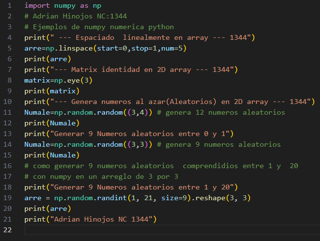
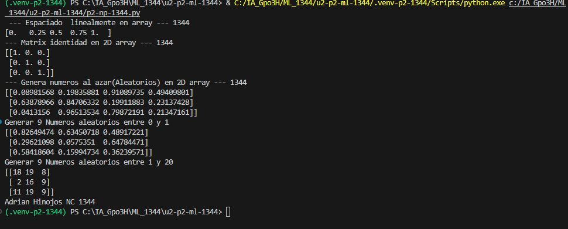

- `start=0`: Indica el valor inicial, que es 0.
- `stop=1`: Indica el valor final, que es 1.
- `num=5`: Indica que se generarán 5 números en total.

## como es np.linspace

`linspace()` es una función de NumPy que genera una cantidad determinada de números igualmente espaciados entre un valor inicial y uno final.

## El codigo 

## resultado 

